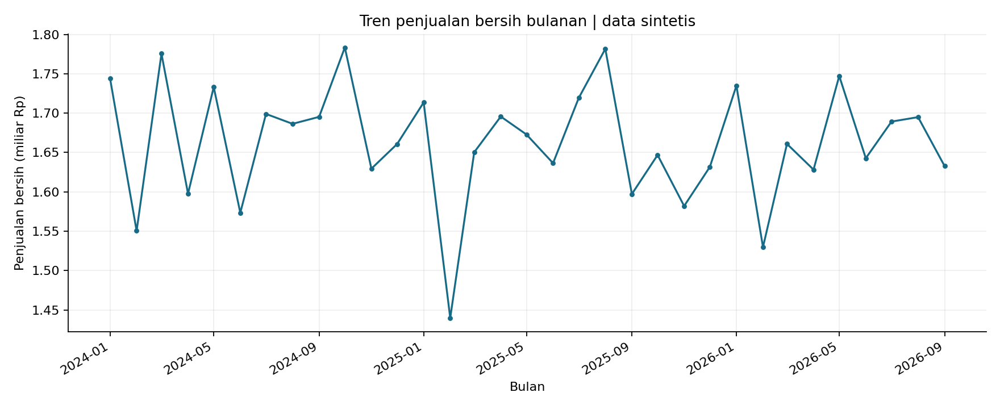
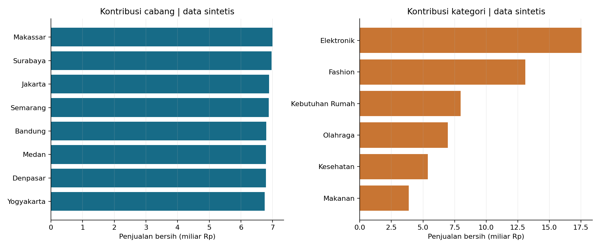
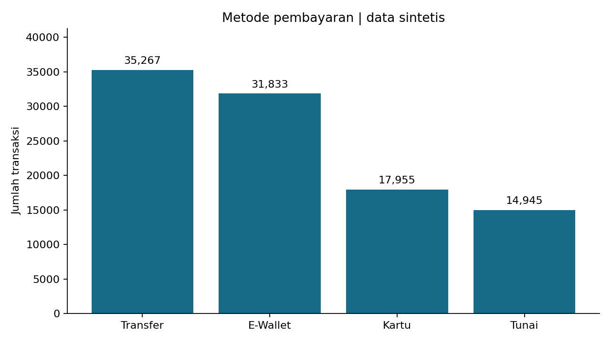

# Big Data Sales Analytics

Studi Kasus 01 - Retail Sales Analytics | akun GitHub: [rayhankonan](https://github.com/rayhankonan)

Proyek tugas Big Data: CSV sintetis 100.000 baris / 12 kolom -> profiling Pandas dan SQL -> PySpark -> Parquet Snappy dan PostgreSQL 15 -> validasi -> tiga grafik Matplotlib -> insight dan rekomendasi.

Mulai dari [MULAI_DI_SINI.md](MULAI_DI_SINI.md). Laporan akhir ada di [reports/laporan_akhir.pdf](reports/laporan_akhir.pdf) dan versi Markdown. Hasil terukur ada di `output/`; angka laporan dihitung dari eksekusi aktual.


## Ringkasan hasil

| Metrik | Hasil |
|---|---:|
| Transaksi | 100.000 |
| Unit terjual | 551.507 |
| Penjualan bersih | Rp54.856.691.900,00 |
| Cabang dengan net sales terbesar | Makassar |
| Kategori dengan net sales terbesar | Elektronik |
| Metode pembayaran paling sering | Transfer |

Hasil berasal dari data sintetis pada proyek. Bukti validasi dan pengukuran tersimpan di `output/`.





## Clone repository

```bash
git clone https://github.com/rayhankonan/TUGAS-AKHIR-BIG-DATA.git
cd TUGAS-AKHIR-BIG-DATA
```

## Struktur repository

```text
big-data-sales-analytics/
├── data/          # CSV sumber dan acuan agregasi
├── notebooks/     # 3 notebook dengan output eksekusi
├── sql/           # Schema PostgreSQL dan query analisis
├── scripts/       # Validasi, pengujian dan generator laporan
├── output/        # Grafik, agregasi, Parquet, validasi, benchmark
├── reports/       # Laporan PDF/Markdown dan outline presentasi
├── docs/          # Panduan, tugas dan catatan pengembangan
├── tools/         # Helper PowerShell untuk lingkungan lokal
├── sales_project.py
├── run_pipeline.py
├── load_to_postgres.py
├── requirements.txt
└── .env.example
```

## Berkas utama

| Lokasi | Isi |
|---|---|
| notebooks/01_exploration.ipynb | Profiling Pandas dan SQL sumber, output eksekusi |
| notebooks/02_pyspark_transform.ipynb | Transformasi, karantina, agregasi, grafik, Parquet |
| notebooks/03_etl_validation.ipynb | ETL PostgreSQL, rekonsiliasi, ringkasan performa |
| sales_project.py | Implementasi pipeline yang digunakan notebook dan CLI |
| data/ | CSV sumber 100k dan acuan agregasi bulanan |
| sql/ | DDL, query analisis, profiling sumber |
| output/aggregates/ | Empat agregasi CSV: bulan, cabang, kategori, pembayaran |
| output/parquet/ | Transaksi tertransformasi dan empat agregasi Parquet |
| output/charts/ | Tiga grafik PNG |
| output/validation/ | Hasil checks, karantina, audit dan rekonsiliasi SQL |
| output/performance_*.csv | Semua ulangan dan median 10k / 100k / 1m |
| reports/ | Laporan, checklist rubrik, outline presentasi |
| docs/ | Panduan dan catatan pengembangan |

## Runtime yang digunakan

Python 3.12, Java 17, Spark 3.5.3, PostgreSQL 15. Versi library dipatok di requirements.txt; requirements-lock.txt mencatat environment pengujian lengkap.

Spark berjalan lokal (`local[2]`, driver 2 GiB). Transformasi dan agregasi menggunakan PySpark. Penyimpanan Parquet menggunakan Arrow setelah hasil Spark dikumpulkan ke driver, untuk kompatibilitas Windows tanpa Hadoop DLL. Spark juga membaca ulang Parquet. Untuk data produksi yang melebihi memori driver, ganti tahap storage dengan writer Spark terdistribusi pada Linux/cluster.

## Jalankan pada Windows

1. Siapkan Python 3.12 dan Java 17, lalu buat virtual environment:

```powershell
.\tools\setup_python.ps1
```

Jika Python 3.12 tidak terdaftar pada `py`, berikan path dengan `-Python 'C:\path\python.exe'`.

2. Database lab portabel dan Java tersedia pada folder kerja lengkap `.runtime/`. Arsip pengumpulan tidak menyertakan runtime. Gunakan:

```powershell
.\tools\start_lab.ps1
.\tools\run_all.ps1
.\tools\stop_lab.ps1
```

Database portabel memakai loopback `127.0.0.1:55439`, role postgres, dan local trust untuk data sintetis. Hanya untuk lab lokal. Data cluster disimpan pada `.runtime/pgdata/`. Jangan memindahkan cluster saat server masih berjalan.

Alternatif PostgreSQL 15 sendiri: buat database khusus memakai `sql/create_database.sql`, salin `.env.example` menjadi `.env`, lalu isi koneksi. `sql/schema.sql` dijalankan otomatis oleh loader. **Loader mengganti isi tabel proyek `sales_lab` dalam transaksi**; gunakan database khusus.

```powershell
$env:JAVA_HOME='C:\path\java17'
.\.venv\Scripts\python.exe run_pipeline.py
```

`run_pipeline.py` menjalankan eksplorasi, Spark, PostgreSQL wajib, dan benchmark. Jika koneksi database gagal, proses berhenti dengan error; PostgreSQL tidak dilewati diam-diam.

## Notebook dan tahap terpisah

Buka notebook pada VS Code/Jupyter dan pilih interpreter `.venv\Scripts\python.exe`. Jalankan notebook 01, 02, lalu 03. Path data diambil relatif terhadap proyek, tanpa path `/content`.

```powershell
.\.venv\Scripts\python.exe sales_project.py explore
.\.venv\Scripts\python.exe sales_project.py spark
.\.venv\Scripts\python.exe sales_project.py postgres
.\.venv\Scripts\python.exe sales_project.py benchmark
.\.venv\Scripts\python.exe scripts/test_quality_policy.py
.\.venv\Scripts\python.exe scripts/validate_outputs.py
.\.venv\Scripts\python.exe scripts/execute_notebooks.py
.\.venv\Scripts\python.exe scripts/generate_report.py
```

Untuk Google Colab/Linux, pasang requirements dan Java 17; unggah/clone seluruh struktur proyek. Konfigurasikan koneksi PostgreSQL lab sendiri. Skrip PowerShell hanya untuk Windows; Python dan notebook memakai path portabel.

## Kebijakan kualitas

Tipe dan tanggal distandarkan. Dimensi dinormalisasi whitespace. Baris wajib kosong/invalid, tanggal gagal parse, jumlah noninteger/tidak positif, harga negatif, diskon di luar 0-1, dan formula salah dikarantina. Semua kemunculan ID duplikat ditolak; nilai uang tidak diimputasi. Sumber utama bersih, sehingga fixture rusak menguji penolakan secara terpisah.

Gross = quantity x unit_price; net = gross x (1-discount_rate). Spark memakai Decimal dan PostgreSQL memakai NUMERIC. Selisih uang diuji dengan toleransi absolut Rp0,02 (`rtol=0` pada Pandas), bukan toleransi relatif. Field sumber dan empat agregasi PostgreSQL dibandingkan kembali dengan hasil transformasi.

## Performa dan batas interpretasi

Tiga ulangan pada 10k, 100k, dan 1m; laporkan median per fase dan total. 10k adalah baris pertama; 100k sumber asli; 1m pengulangan sumber dengan ID baru. Ada satu warmup, Spark dipaksa melakukan action; cache OS tidak dibersihkan. Fase collect driver dicatat terpisah. Kedua engine memakai writer Arrow dan reader Pandas yang sama. Ini pengujian alur lab lokal, bukan throughput cluster.

Data sintetis bukan bukti kondisi pasar aktual. Penjualan bukan laba; tidak tersedia margin, persediaan, kalender promosi, atau biaya pembayaran. Rekomendasi laporan adalah arah kajian dengan batasan tersebut.

## Asal proyek

Dikembangkan dari https://github.com/ruhyana/big-data-sales-analytics. Commit sumber, hash dataset, serta perubahan dicatat pada SOURCE_PROVENANCE.json dan docs/perubahan_proyek.md. Tugas asli tetap tersedia pada folder kerja lokal sebagai referensi. Kredensial pribadi tidak disertakan.
