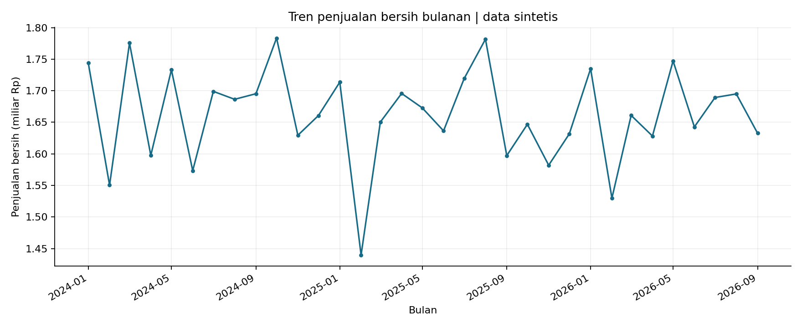
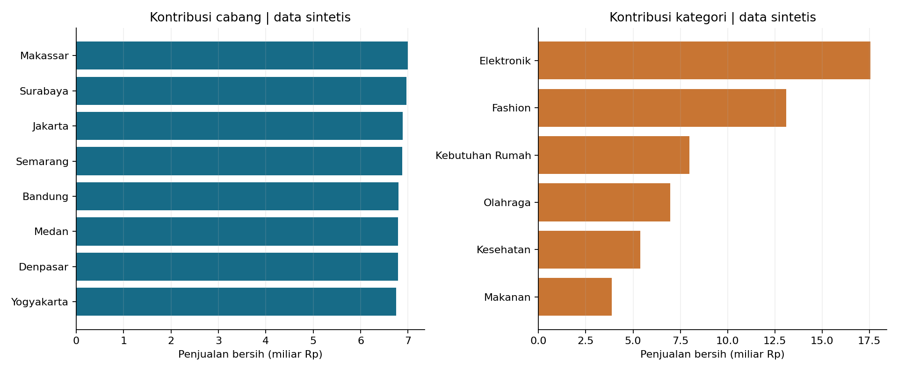
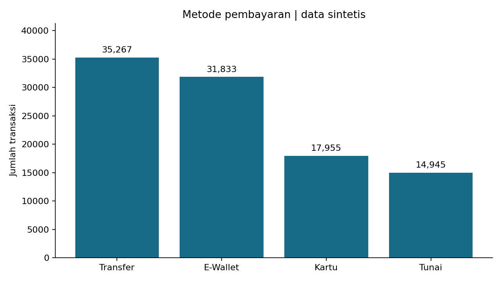

# Laporan Studi Kasus 01 - Retail Sales Analytics

Disusun dari eksekusi aktual pada 21-10-2026 14:01 WIB. Data sintetis, bukan data pribadi.

## Ringkasan

Proyek memproses 100.000 transaksi dengan 551.507 unit dan penjualan bersih Rp 54.856.691.900,00. Pipeline menggabungkan Pandas/SQL, transformasi PySpark 3.5.3, Parquet Snappy, PostgreSQL 15, validasi, serta tiga grafik Matplotlib.

## Rumusan masalah dan pemahaman data

1. Bagaimana tren penjualan bersih bulanan?
2. Cabang dan kategori mana yang memberi kontribusi penjualan terbesar?
3. Metode pembayaran mana yang paling sering digunakan?

Sumber: dataset sintetis dalam repositori ruhyana/big-data-sales-analytics, diunduh dari GitHub. Dataset memiliki 100.000 baris dan 12 kolom: transaction_id, transaction_date, branch, category, product_name, quantity, unit_price, discount_rate, gross_sales, net_sales, payment_method, customer_segment. Satu baris adalah satu catatan transaksi produk; rata-rata penjualan dihitung per catatan transaction_id, bukan per pelanggan unik. Rentang tanggal: 2024-01-01 sampai 2026-09-30.

## Metode

CSV -> profiling Pandas dan SQL sumber (SQLite) -> transformasi PySpark -> Parquet Snappy dan PostgreSQL 15 -> rekonsiliasi -> grafik dan rekomendasi. PostgreSQL wajib dan telah diuji; SQLite hanya alat profiling sumber.

Transformasi: tipe tanggal dan angka eksplisit; normalisasi whitespace dimensi; gross = quantity x unit_price; net = gross x (1-discount_rate); discount_amount = gross-net; month; basket_band (High >= Rp1 juta, Medium >= Rp500 ribu, selain itu Low). Metrik uang memakai desimal di Spark dan NUMERIC di PostgreSQL. Toleransi perbandingan adalah absolut Rp0,02.

Baris dengan nilai wajib kosong/invalid, tanggal gagal parse, jumlah tidak positif/noninteger, harga negatif, diskon di luar 0-1, atau formula salah dikarantina. Semua kemunculan ID duplikat ditolak. Tidak dilakukan imputasi nilai uang. Sumber utama bersih; kebijakan diuji dengan fixture rusak yang terpisah.

Empat agregasi dihitung menurut bulan, cabang, kategori, serta metode pembayaran. Setiap tabel berisi jumlah transaksi, unit, dan penjualan bersih. Hasil transformasi dikumpulkan ke driver dan ditulis melalui Arrow, lalu dibaca ulang dengan Pandas dan Spark. Tabel PostgreSQL dimuat dalam satu transaksi; gagal validasi menyebabkan rollback. Audit mencatat status, waktu, dan jumlah baris.

## Hasil dan insight

- Gross sales: Rp 58.074.226.000,00
- Diskon total: Rp 3.217.534.100,00
- Net sales: Rp 54.856.691.900,00
- Rata-rata per transaksi: Rp 548.566,92

1. Puncak penjualan bulanan terjadi pada 2024-10, sebesar Rp 1.783.478.200,00 dari 3.158 transaksi.
2. Makassar menghasilkan penjualan bersih terbesar, Rp 6.996.060.300,00, atau 12,75% dari total.
3. Kategori Elektronik menyumbang Rp 17.545.252.850,00 atau 31,98% dari total pendapatan bersih.
4. Metode Transfer digunakan pada 35.267 transaksi (35,27%).

## Validasi

- rows_100000: PASS
- at_least_10_columns: PASS
- unique_ids: PASS
- no_nulls: PASS
- valid_dates: PASS
- nonempty_dimensions: PASS
- finite_numbers: PASS
- positive_integer_quantity: PASS
- nonnegative_price: PASS
- discount_range: PASS
- gross_formula: PASS
- net_formula: PASS
- Spark: 100000 input, 100000 diterima, 0 invalid, 0 duplikat.
- Referensi bulanan, profiling SQL sumber, serta baca ulang Parquet: PASS.
- PostgreSQL: 100000 baris; perbandingan setiap field sumber dan empat agregasi: PASS; formula mismatch: 0.
- Uji input rusak: 9 input, 1 diterima, 6 invalid, 2 duplikat; whitespace dinormalisasi dan selisih Rp1 ditolak.

Server uji: PostgreSQL 15.19, compiled by Visual C++ build 1944, 64-bit. Bukti terstruktur terdapat di output/validation/. Tidak ada kredensial dalam laporan.

## Uji performa

Tiga ulangan untuk 10 ribu, 100 ribu, dan 1 juta baris; angka berikut adalah median. Spark memakai local[2] dan driver 2 GiB. Satu warmup JVM dikecualikan. Waktu baca CSV dipaksa dengan cache/count, transformasi mencakup agregasi bulan-cabang-kategori, lalu pengumpulan ke driver, penulisan Arrow Parquet, serta baca ulang Pandas. Kerja Spark dipicu melalui action, bukan hanya definisi transformasi. Engine dijalankan berurutan; cache OS tidak dibersihkan. Median total dihitung dari total per ulangan, sehingga tidak wajib sama dengan jumlah median setiap fase.

| Engine | Baris | Baca CSV (s) | Transformasi (s) | Collect (s) | Tulis (s) | Baca ulang (s) | Total (s) |
|---|---:|---:|---:|---:|---:|---:|---:|
| pandas | 10.000 | 0.010 | 0.023 | 0.001 | 0.010 | 0.010 | 0.055 |
| pandas | 100.000 | 0.078 | 0.203 | 0.022 | 0.062 | 0.029 | 0.380 |
| pandas | 1.000.000 | 0.632 | 2.117 | 0.227 | 0.562 | 0.216 | 3.724 |
| spark | 10.000 | 0.163 | 0.256 | 0.092 | 0.011 | 0.010 | 0.531 |
| spark | 100.000 | 0.259 | 0.339 | 0.603 | 0.080 | 0.029 | 1.326 |
| spark | 1.000.000 | 1.273 | 1.103 | 6.165 | 0.749 | 0.216 | 9.552 |

Data 10k mengambil baris pertama, 100k adalah sumber asli, sedangkan 1 juta adalah pengulangan sumber dengan ID baru. Hasil ini menggambarkan biaya alur lab lokal; bukan bukti throughput cluster. Biaya scheduling, JVM, dan collect dapat membuat Spark lebih lambat pada data ini. Pilihan Spark dibenarkan oleh pembelajaran transformasi terdistribusi, bukan klaim kecepatan pada 100 ribu baris. Rincian semua ulangan dan spesifikasi tersimpan di output/performance_runs.csv, output/performance_method.json, dan output/runtime.json.

## Rekomendasi

1. Gunakan Makassar sebagai titik awal kajian praktik operasional cabang. Bandingkan jumlah transaksi dan nilai rata-rata sebelum menyalin strategi; penjualan bukan laba.
2. Prioritaskan tinjauan ketersediaan produk Elektronik karena kontribusinya besar. Keputusan pembelian stok perlu data margin, stok, lead time, dan permintaan yang belum tersedia.
3. Pastikan kanal pembayaran Transfer tetap mudah digunakan dan dipantau. Evaluasi biaya, tingkat gagal, dan waktu settlement sebelum menentukan promosi pembayaran.
4. Gunakan tren bulanan untuk merencanakan evaluasi kampanye. Jangan menyimpulkan pola musiman berulang dari satu bulan puncak atau membandingkan tahun parsial dengan tahun penuh.

## Keterbatasan

- Seluruh data sintetis: hasil menguji alur analitik dan tidak menggambarkan pasar retail Indonesia yang sebenarnya.
- Rentang observasi 2024-01-01 sampai 2026-09-30; perbandingan tahun harus memperhatikan cakupan bulan yang berbeda.
- Tidak tersedia harga pokok, margin, persediaan, target, atau identitas pelanggan. Penjualan tertinggi tidak berarti laba tertinggi dan penyebab perbedaan belum dapat dibuktikan.
- Spark berjalan pada satu laptop dengan dua thread. Pengumpulan ke driver dan penulisan Arrow sesuai lab, tetapi membatasi skala memori. Produksi besar memerlukan penulisan Spark terdistribusi.
- Uji 1 juta baris mengulang sumber dengan ID baru; tidak menambah keragaman bisnis. Benchmark mencakup cache OS yang tidak dibersihkan dan proses lain pada komputer.

## Reproduksi dan berkas

Lihat README.md dan MULAI_DI_SINI.md. Jalankan tiga notebook berurutan, atau python run_pipeline.py setelah konfigurasi Java 17 dan PostgreSQL 15. Gunakan database lab khusus. Skrip load mengganti isi tabel sales_lab milik proyek. Identitas nama/NIM/kelompok perlu diisi sendiri sebelum pengumpulan.

Referensi: Tugas_studi_kasus_big_data.pdf, halaman 2-4 dan 14-17; https://github.com/ruhyana/big-data-sales-analytics . Commit sumber dicatat pada SOURCE_PROVENANCE.json. Formula dan insight dihitung ulang dari data, bukan disalin dari README lama.
